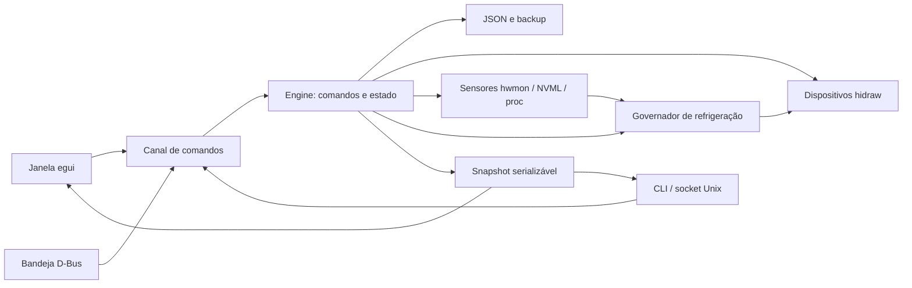

# Arquitetura do NZXT CAM para Ubuntu

**Estado: implementado, sem validação no Ubuntu.** Os módulos abaixo existem e
passam nos testes automáticos; os protocolos dos dispositivos dependem da
[referência Windows](REFERENCIA_WINDOWS.md). O desenho segue o porte do Facecam Hub
(`ubuntu-elgato-facecam`): um controlador único atende janela, bandeja e linha de
comando, e as interfaces só apresentam estado e enviam pedidos.

## Fluxo de dependências

O núcleo não depende de egui. Uma alteração de UI não cria outra implementação
de aplicar perfil, salvar ou ler sensores.

## Módulos

| Módulo | Responsabilidade | Equivale no Facecam Hub |
| --- | --- | --- |
| `devices.rs` | Descoberta em sysfs por VID/PID, `Transport` sobre hidraw com `poll` seguro, identidade por serial ou caminho USB, detecção de conflito por `/proc/*/fd` | `camera.rs` |
| `driver.rs` | Interface comum dos dispositivos: canais, limites, status, perfil, duty e iluminação | — |
| `kraken_x.rs` | Protocolo do Kraken X52/X62/X72: status (líquido, bomba, fan), perfis de bomba/fan, iluminação Ring/Logo | parte de `camera.rs` |
| `smart_device.rs` | Protocolo do Smart Device V1: três fans, canal de iluminação, sensor de ruído | parte de `camera.rs` |
| `protocol.rs` | Codificação e decodificação dos relatórios HID, sem E/S, testável com amostras | — |
| `sensors.rs` | CPU (`coretemp`/`k10temp`, `/proc/stat`), GPU (NVML carregada sob demanda, `amdgpu`), RAM (`/proc/meminfo`), armazenamento (`nvme`/`drivetemp`), rede (`/proc/net/dev`) | `stream.rs` (fonte contínua) |
| `curves.rs` | Perfis Silent/Performance/Fixed/Custom, interpolação, pisos e validação | `effects.rs` |
| `lighting.rs` | Modos, cores, opções de cada modo, validação por dispositivo e quadros dos modos de áudio | `effects.rs` |
| `audio.rs` | Captura do som do sistema (`parec` ou `pw-record`) e análise de volume e graves, ativa só com modo de áudio em uso | — |
| `governor.rs` | Laço que lê sensores, calcula rotações e escreve nos dispositivos | worker de `ai.rs` |
| `profiles.rs` | Perfis por dispositivo e Profile Sync (ativação por programa ou horário) | `resources.rs` |
| `permissions.rs` | Plano revisável e helper restrito para a regra udev | `virtual_camera.rs` |
| `engine.rs` | Comandos, transições, persistência e snapshot | igual |
| `config.rs`, `i18n.rs`, `ipc.rs`, `tray.rs`, `desktop.rs` | Persistência, idioma, controle local, bandeja e integração desktop | igual |
| `installation.rs`, `updater.rs` | Identidade do build, registro da instalação e atualização explícita pelo commit de produção, em worker separado | mesmo fluxo do Facecam Hub, adaptado ao instalador do CAM |
| `gui.rs` | egui com layout do CAM: navegação lateral, Monitoramento, Refrigeração, Iluminação, Configurações e Profile Sync; Mini Mode removido | igual |

## Comandos e estado

`Request` é um enum serializável com discriminador `command`; `Reply` traz `ok`,
`message` e um `Snapshot`. O snapshot contém configuração, dispositivos e seu estado
(inicializando, pronto, falha, conflito), leituras de sensores com instante da
leitura, rotações aplicadas, perfis ativos e erros. Apenas o controlador modifica
o estado operacional.

O socket Unix aceita uma mensagem JSON por linha, com limite por pedido, em
diretório do usuário com modo 0700. Uma trava impede dois controladores. Isso
também evita dois processos escrevendo no mesmo hidraw.

Profile Sync salva perfis de iluminação e refrigeração separados e os combina em
perfis mestres. Toda ativação passa por validação de todos os canais antes de E/S;
falhas não são apresentadas como ativação bem-sucedida. Regras por executável ou
horário local são avaliadas pelo controlador, inclusive no modo headless.

Atualizações só começam por pedido explícito. O worker de Git/Cargo não bloqueia
o governador, tem tempos limite e cancela apenas seu grupo de subprocessos ao
encerrar. O estado **Reiniciar** exige uma nova ação; antes de trocar de processo,
o controlador prepara o estado térmico de saída e recusa o reinício se isso falhar.
Instalação e reinício reais ainda precisam ser validados no Ubuntu.

## Segurança térmica

O governador é a parte crítica do produto. As regras abaixo têm precedência sobre
qualquer recurso de interface.

1. **Curva de segurança no dispositivo.** Ao assumir um Kraken X, o controlador
   grava antes de tudo um perfil interno baseado na temperatura do líquido, que o
   próprio firmware executa. Se o aplicativo parar, travar ou for morto, a bomba e
   o fan continuam reagindo ao líquido. Curvas por CPU/GPU são calculadas pelo
   governador e escritas por cima, enquanto ele estiver vivo.
2. **Smart Device V1 sem perfil interno.** O dispositivo mantém a última rotação
   fixa. Ao sair normalmente, o controlador grava o valor de saída configurado
   (padrão: 100%). Uma morte abrupta mantém a última rotação: é uma **limitação
   conhecida**, mitigada pelos pisos mínimos das curvas e pela reinicialização
   automática do serviço de sessão.
3. **Fonte indisponível.** Sensor ausente, leitura velha ou erro de NVML levam o
   canal ao valor de segurança do perfil, nunca ao último valor calculado, e o
   erro aparece no snapshot.
4. **Pisos e limites.** Toda curva é validada contra o piso do canal; a bomba tem
   piso próprio, maior que o dos fans. Valores não finitos, pontos fora de ordem
   e curvas decrescentes são recusados.
5. **Leitura de volta.** Depois de escrever, o controlador compara o status
   relatado (RPM, duty) com o pedido e publica divergências.
6. **Suspensão.** Ao retomar, os dispositivos são reabertos e o perfil é reaplicado
   antes de o governador voltar a escrever.

O período do governador e a histerese ficam no perfil; o padrão proposto é 1 s,
com suavização para evitar oscilação audível.

## Acesso aos dispositivos

Os nós `/dev/hidraw*` pertencem ao root por padrão. `PreparePermissions` gera um
plano com a regra `/etc/udev/rules.d/71-nzxt-cam.rules`, que concede acesso
à sessão ativa (`TAG+="uaccess"`) somente para os VID/PID suportados. Após
confirmação, uma única chamada `pkexec` executa o modo restrito
`--permissions-helper` do próprio binário, que grava a regra por arquivo temporário
e rename e recarrega o udev. O aplicativo nunca roda como root.

A comunicação usa leitura e escrita de relatórios no hidraw por `std::fs`, sem
`unsafe`. Se um dispositivo exigir feature reports (ioctl), a escolha entre um
crate seguro e outra solução é registrada em [Decisões](DECISOES.md).

Outro programa usando o mesmo dispositivo (liquidctl, CoolerControl) é detectado
como conflito, como no CAM, e o controlador não escreve até a pessoa resolver.

## Configuração e persistência

O arquivo fica em `~/.config/nzxt-cam/config.json`, respeitando
`XDG_CONFIG_HOME`. Campos adicionais na raiz são preservados; JSON inválido
permanece intacto; o primeiro salvamento mantém `config.json.backup`. Perfis
pertencem ao computador; o único estado gravado no dispositivo é a curva de
segurança do Kraken e a última rotação/iluminação enviada.

## Extensão e limites

Um dispositivo novo precisa de evidência de protocolo na referência, módulo
próprio, validação de faixas e teste sem hardware. Firmware, conta NZXT,
telemetria e as demais famílias do CAM ficam fora do escopo atual.
